<!-- vscode-markdown-toc -->
* 1. [ 背景](#01)
* 2. [ 文件详情](#02)
	* 2.1. [ 字表与字体](#021)
	* 2.2. [ 带v0.x.x版本号的文件夹](#v0.x.x)
* 3. [ 成本记录](#03)
* 4. [ 进度](#04)
	* 4.1. [ （update 20260910）3D文件_v0.4.0](#update202609103D_v0.4.0)
	* 4.2. [ （update 20260818）](#update20260818)
	* 4.3. [ （update 20260811）](#update20260811)
	* 4.4. [ （update 20260802）](#update20260802)
	* 4.5. [ （update 20260711）结构测试_v0.3.1](#update20260711_v0.3.1)
	* 4.6. [ （update 20260703）结构测试_v0.3.0](#update20260703_v0.3.0)
	* 4.7. [ （update 20250424）结构测试_v0.2.2 (for 3Dprint)](#update20250424_v0.2.2for3Dprint)
	* 4.8. [ （update 20250401）](#update20250401)
	* 4.9. [ （update 20250319）](#update20250319)
	* 4.10. [ （update 20250316）](#update20250316)
* 5. [ 目前问题](#05)

<!-- vscode-markdown-toc-config
	numbering=true
	autoSave=true
	/vscode-markdown-toc-config -->
<!-- /vscode-markdown-toc -->

# Chinese Mingkwai Typewriter/明快中文打字机

[![CC BY-NC 4.0][cc-by-nc-shield]][cc-by-nc]

本项目使用CC BY-NC 4.0进行许可。This work is licensed under a
[Creative Commons Attribution-NonCommercial 4.0 International License][cc-by-nc].

[![CC BY-NC 4.0][cc-by-nc-image]][cc-by-nc]

[cc-by-nc]: https://creativecommons.org/licenses/by-nc/4.0/
[cc-by-nc-image]: https://licensebuttons.net/l/by-nc/4.0/88x31.png
[cc-by-nc-shield]: https://img.shields.io/badge/License-CC%20BY--NC%204.0-lightgrey.svg

这是一个开源项目，欢迎DIYer在此基础上转载/改进/魔改，但请标注来源。禁止盗用、未授权的商用。

##  1.  背景

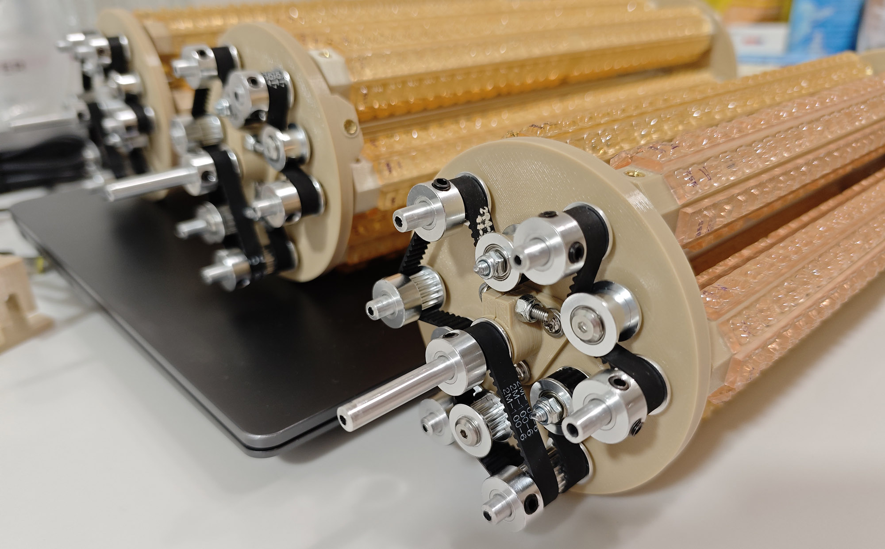

这是一个我的个人项目，我试图用现代科技来低成本的复现明快打字机，因此不拘泥于纯机械的执念，我的目标是先快速将他运行。

另外，低成本的实现也能帮助更多人自己做或者研究这个东西。

BiliBili上有同步更新的视频进度与项目预览：[视频合集：开源明快计划](https://space.bilibili.com/5147613/lists/5302713)

##  2.  文件详情

###  2.1.  字表与字体

所有文件的基础来自于网站[https://mingkwai.atelier-anchor.com/](https://mingkwai.atelier-anchor.com/)

但此网站目前（截至2026年7月3日）暂时更新不可见。

字表的源头文件来源为林语堂故居公开资料 [明快打字機_檢字表模型.pdf - Google 云端硬盘](https://drive.google.com/file/d/15jLOnOuoSWHxG32Q2Wv88wtTFPuZbgWq/view?usp=drive_link)

字模文件待其字体版权所属团队[atelier-anchor.com](https://atelier-anchor.com/)开源发布后，字模所用的加工图纸会同步到本仓库内

**⚠️项目中展示的字模图样、编码示意图、字体设计等，其原版权归属于原设计团队，本项目仅用于验证机械结构寻址和动作的测试展示，实物仅用于个人研究，绝不用于任何商业用途。**

---

###  2.2.  带v0.x.x版本号的文件夹

齿轮组与字轴滚筒的联动设计，主要用来测试运动与装配，需要用SolidWorks打开。

##  3.  成本记录

| 材料\工艺                              | 价格 (￥)   |
| ------------------------------------- | -----      |
| ------ 以下是已经付款确认的部分 ------  | -----      |
| 柔性树脂印版                           | 900        |
| ------ 以下是还在购物车里的 ------      |   -----    |
| Arduino mega2560（后期开发尽可能兼容uno以再省点成本） | ≈60（祖国版）   |
| USB Host Shield*                       | 19.2       |
| USB有线薄膜键盘                         | 9.9        |
| 键盘轴和键帽                            |            |
| 42步进电机（长23）                      |            |
| 闭环驱动                                | （可能没必要，且贵） |
| 同步带/轮                               |            |
| 铝合金/不锈钢轴                          |            |
| 3D打印部件耗材+工费（倘若你没有3D打印机）  |            |
| 治具成本                                |            |
| 所需工具（手钻、砂纸、锉刀……）            |            |
| Todo                                    |            |

*USB Host Shield的库文件：[felis/USB_Host_Shield_2.0: Revision 2.0 of USB Host Library for Arduino.](https://github.com/felis/USB_Host_Shield_2.0) 

##  4.  进度

###  4.1.  （update 20260910）3D文件_v0.4.0

文件夹[3D文件_v0.4.0](3D文件_v0.4.0)需要用SW 2025或者更新的版本打开，包含的是对应第4期视频内容的东西（B轴零件及装配所需的3D打印部件）

五金零件的BOM表暂时先不放了，主要是因为这部分的一些尺寸和数量可能会随着整机的规划有所改变

尤其是金属轴的切割长度（切割长度的合理安排可以减少废料的浪费）

如果实在有手急手快的朋友，可以直接看装配体里面对应模型的尺寸规格去复现

装配体里的涉及的零件我应该都独立保存到SLDASM里面了，如果有丢失或者出错的请提issue

这一版本的文件内容仅作为阶段性备份使用

A柱、完整机头、整机的装配等后续工作，再多给我一些时间

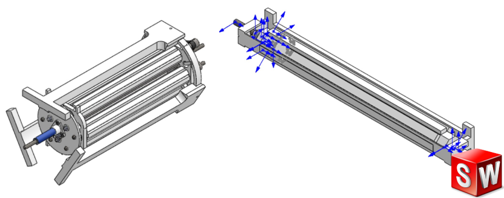

---

###  4.2.  （update 20260818）

以下记录一些动手制作时的记录和trick：

切轴用滚刀，对于5mm轴太细不好拿，使用这样的3D打印的夹子即可：

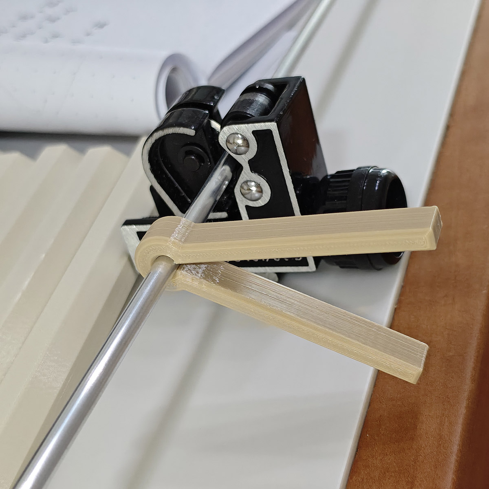

轴两端需要打磨以便套上轴承，用240目砂纸打磨到烫手停下冲水，反复4-5次即可到达差不多的尺寸，然后用1500目磨光滑一些就行了：

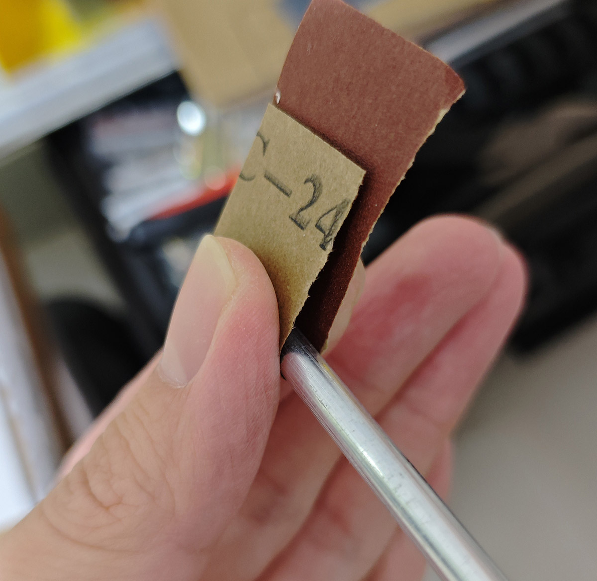

磨轴最好用手钻夹住然后旋转磨，最大可以夹住10mm直径的轴，刚好这个项目用的最粗的轴就是10mm：

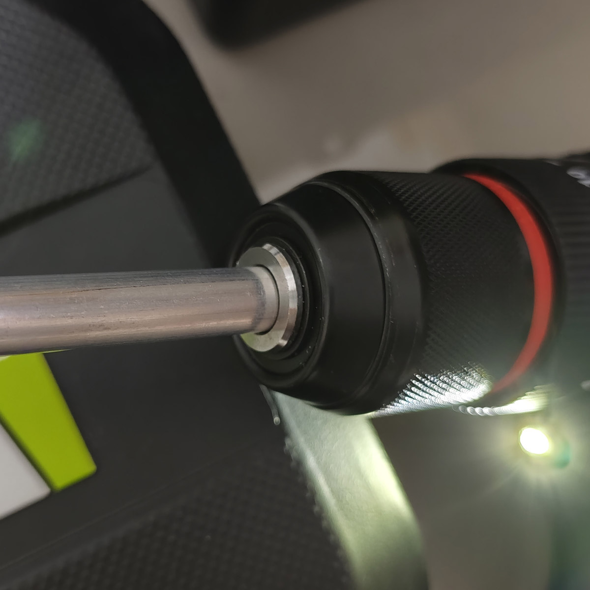

---

###  4.3.  （update 20260811）

确定以下参数：以顺时针（从左侧看方向）排序轴，C轴胶皮贴合治具，C轴所需中心铝合金轴、轴套、轴承参数。

B轴装配基本完成，差一些原料还在路上，下次尝试往A轴上装配。B轴完成验证后将B和C轴图纸与装配先发布再说。

**Todo list：**

1_制造相关/3D打印_C轴装配治具1.SLDPRT

---------------/3D打印_C轴装配治具2.SLDPRT

---------------/3D打印轴套5x7x3.SLDPRT

---------------/3D打印轴套3x8x10.SLDPRT

---------------/3D打印零件_c_roll.SLDPRT

---------------/3D打印零件_B-roll支架_left.SLDPRT

---------------/3D打印零件_B-roll支架_right.SLDPRT

---------------/3D打印_10mm夹紧法兰联轴器.SLDPRT

---------------/3D打印_B轴安装治具.SLDPRT

---------------/3D打印_230mm套筒治具.SLDPRT

---------------/3D打印_B轴治具支架顶.SLDPRT

---------------/3D打印_B轴治具支架柱.SLDPRT

胶皮需要注意防晒，一部分存放在了阳台被晒了，有些变黄。

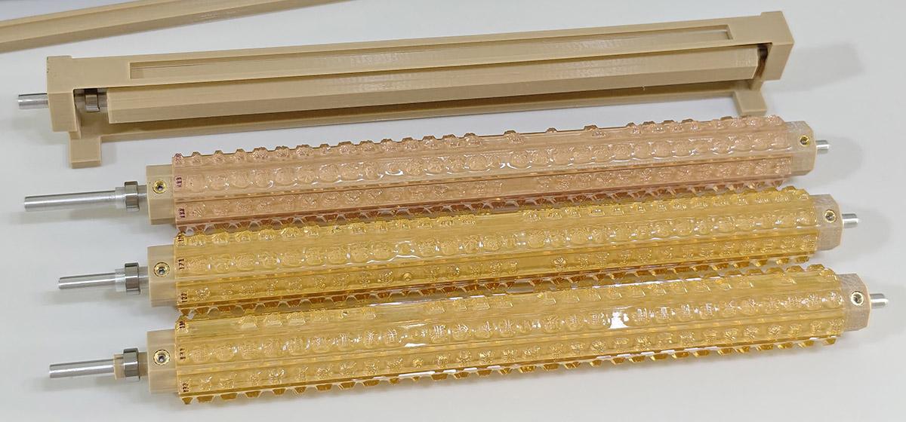

以下是初步完成的B-roll大致尺寸（背景为16寸笔记本电脑）

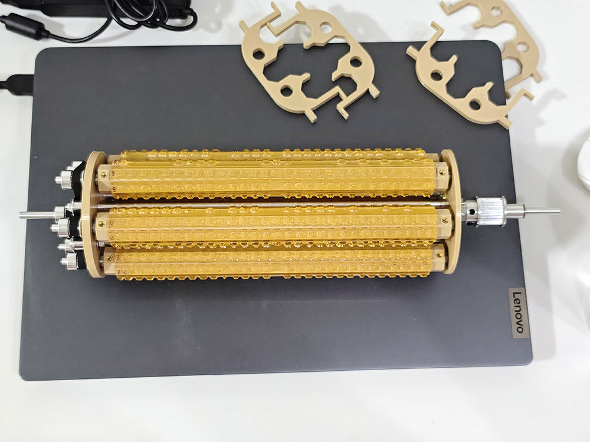

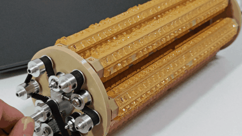

以下是开发笔记备用

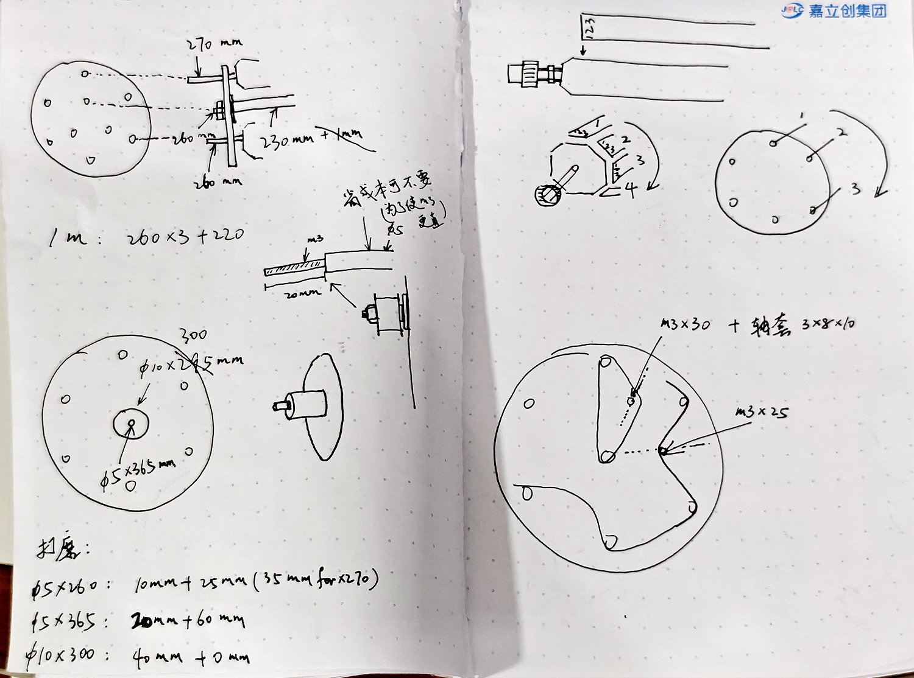

---

###  4.4.  （update 20260802）

字模胶皮全部加工完，带切割好的，共计成本900，实际组装B轴时发现很多细节优化问题，已微调模型

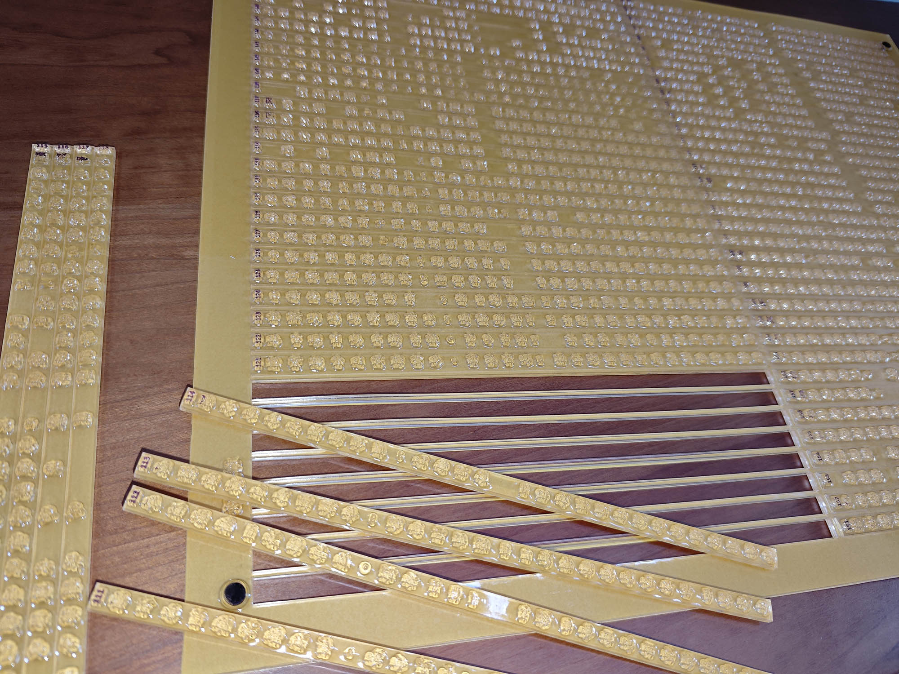

---

###  4.5.  （update 20260711）结构测试_v0.3.1

鉴于同步带计算传动比简单很多，因此着重设计了B-roll的结构，使用了多级皮带轮，需要实际做一下，测试精度和稳定性，曾想过把预览轴用屏幕取代，但是感觉会使原机械风味丧失大半，所以还是保留。

【A-roll：最大的转盘，B-roll：二级转盘，C-roll：八面轴，view-roll：预览轴】

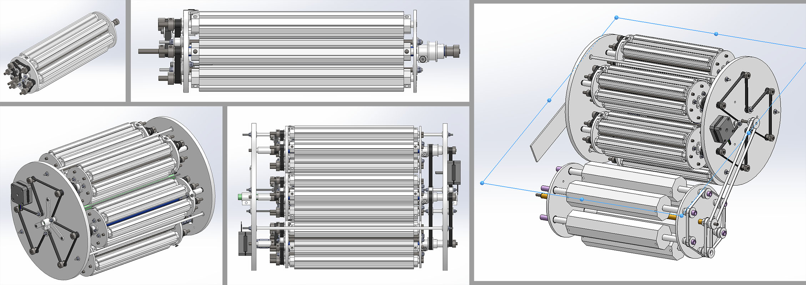

打样了印版，对比测试了两种厚度的柔性树脂印版，肉眼观察树脂印版精度效果极佳，但风险是时间久会变硬，对于盖章的影响目前未知。

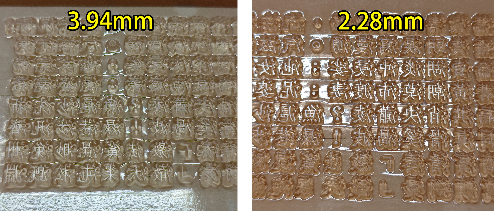

下面展示的是使用印版沾取7021印油盖印的效果，左侧是轻轻施压，右侧是重压，（靠左的文字是薄印版，靠右的字是厚印版，不特别大力压的话，实际效果差别不大，可以哪个便宜做哪个）可以看出柔性印版对压力的要求没有那么高，在指定字上沾墨，轻轻压向纸面即可。

激光雕刻的胶皮不如柔性印版的效果好，盖印时我试了几次都没能完美盖出清晰的字迹。且二者加工成本接近，但是如果提升雕刻精度则会提升工费，且提升效果未知，整体性价比个人认为柔性印版最佳

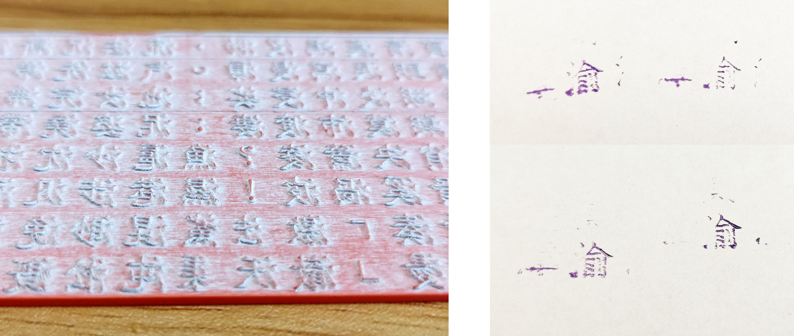

---

###  4.6.  （update 20260703）结构测试_v0.3.0

重构了转轴部分的转盘传动，使用同步带驱动，大幅简化了运动和构造。v0.2.2完全不合理，直接废弃不用看了。

之后的版本需要将设计重心放在电机与轴的配合，代码，如何将字打在纸上（可能会参考回墨戳的设计，鉴于我想要通过橡皮印章方法刻字）

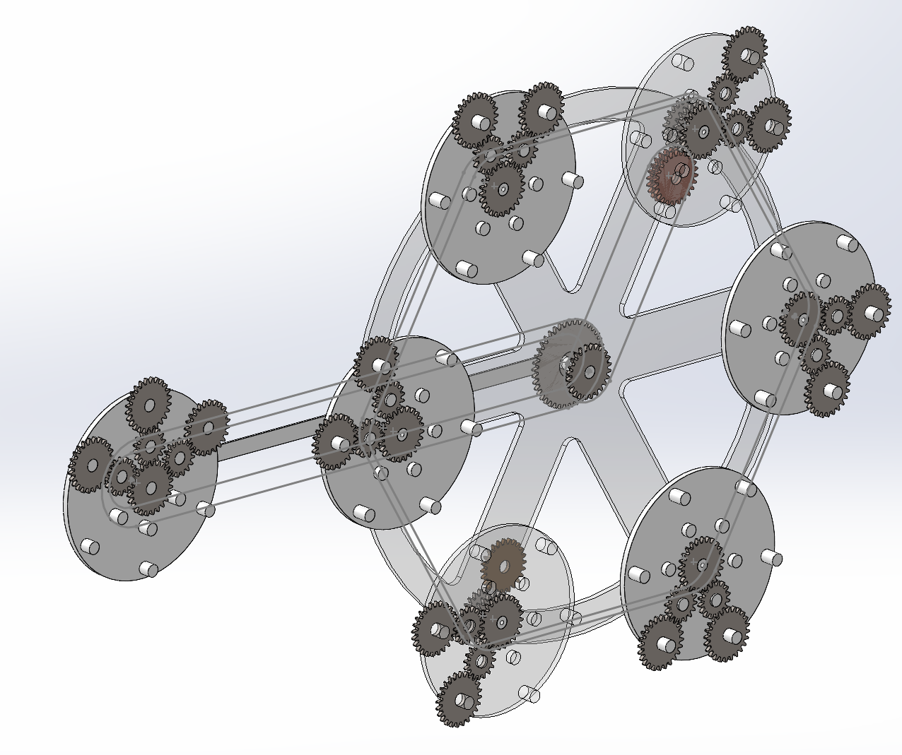

---

###  4.7.  （update 20250424）结构测试_v0.2.2 (for 3Dprint)

将转筒的齿轮编码部分用3D打印制作了一下，用于实际测试装配、尺寸、运动、误差等情况。文件内有这些模型的sw文件（主文件为“大筒装配体”）和stl文件。可直接打印，前缀为所需数量。装配与演示情况见视频：[【开源计划】低成本明快打字机设计方案第二期_哔哩哔哩_bilibili](https://www.bilibili.com/video/BV1TwLZzwEFX/)

文字滚筒也测试了带拔模角度（1mm, 30°）的3D打印模型，能很好的解决小字体下破损的问题。但这种模型的建模目前还未找到很好的办法制作。这个测试模型是用solidworks的拔模功能手调微操做出来的，特别麻烦，无法扩展到大的正式版制作。

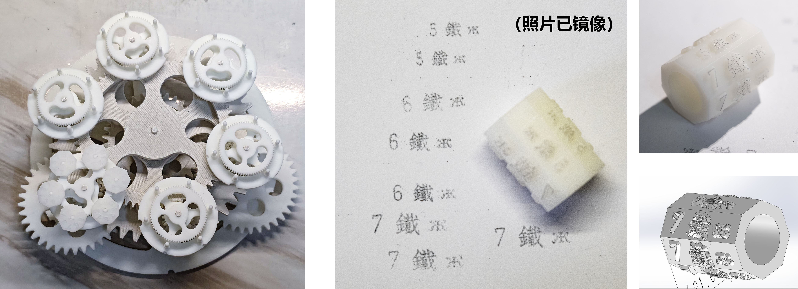

---

###  4.8.  （update 20250401）

光固化树脂打样了一个带字的字轴，如下图，文字凸起均为1mm，数字是字体的高度，单位mm。6mm及以下的字号可能会出现细线缺失的问题。而即使是8mm的大字，点或细线部分，我用手去扣动，感觉牢固性也堪忧。目前在寻找学习如何制作一个下大上小的那种锥形刻面文字的建模效果。solidworks做这种模型无力，得换工具了。

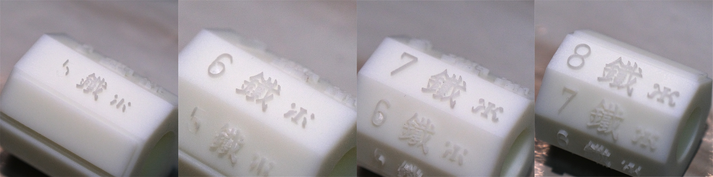

---

###  4.9.  （update 20250319）

稍微精细的建模了转轮组比较重要的运动部分，以便打样测试运动。这部分的sw模型已上传（结构测试_v0.2.1），并且附带有齿轮运动配合关系。

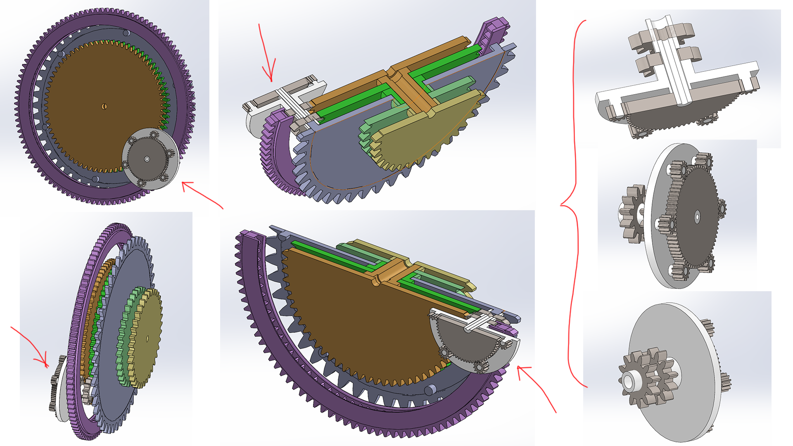

todo：

- 测试当前尺寸下文字雕刻出的效果以及配合墨带印字的清晰度。以便最终确定核心机构的尺寸

- 实际验证没问题后，加上轴承，并且优化解耦出的三个齿轮的动力传动。

---

###  4.10.  （update 20250316）

紧凑的新结构初步验证完毕，可单独控制三个红齿轮的角度，从而完全将运动独立出来，如上图所示。带有预览轴的联动部分以及结构细节以后做。（结构测试_v0.2.0）

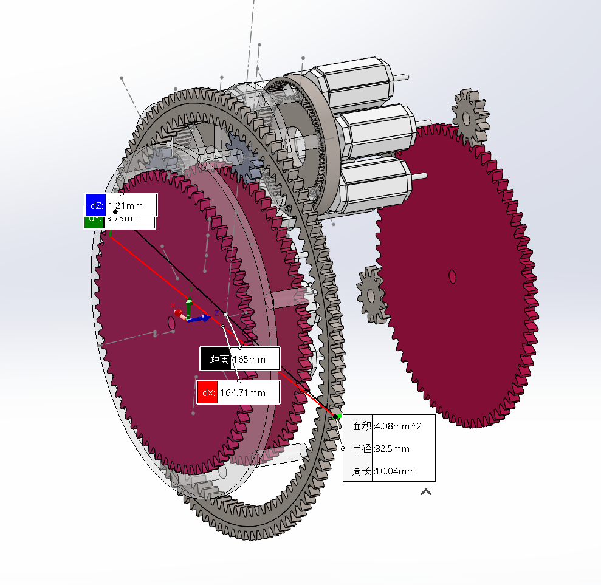

---

（update）简单设想了一个更紧凑的方案，理论上应该兼容机械编码，实际参数和设计还未验证。

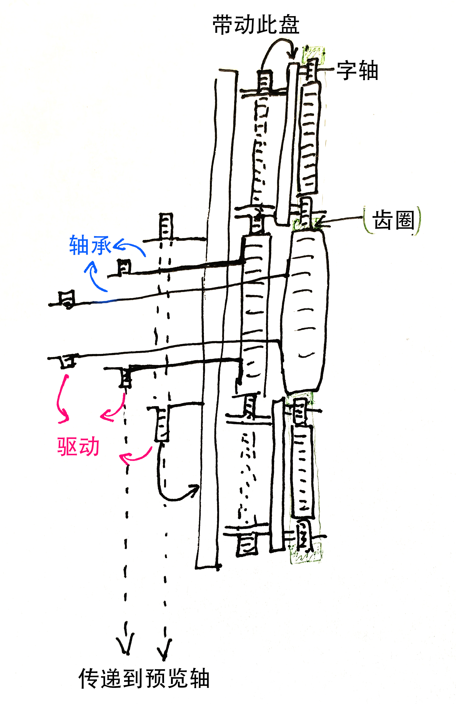

---

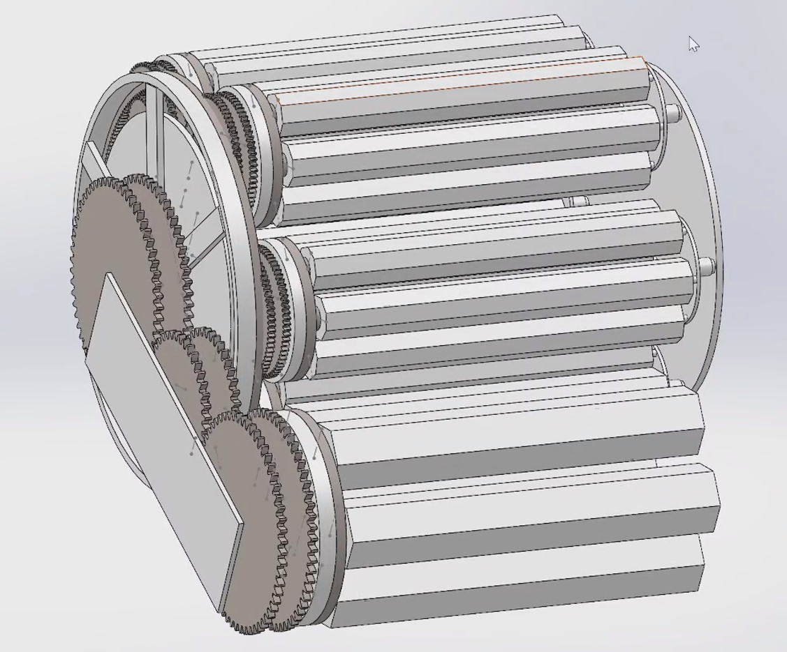

目前设计了3组齿轮独立检索字的结构，齿轮的控制初步设计使用电机控制角度以此检索对应文字的轴。（字模滚筒_v0.1）

下一步先以此结构打样出关键配件，齿轮如有通用件则直接买成品。主要任务是对齿轮部分进行运动验证。

按理说，“电机控制角度”也可以用什么机械结构来实现，但我实在搞不懂。

【我所理解的原始专利对最细轴的控制方法，是用一个类似牙刷样的齿轮齿条去拨动，但是个人感觉那样太不可靠了，干脆都用同样设计思路迭代三层的齿轮为妙。】

机架设计，进纸机构等还没做。

电控的部分也还没弄。

##  5.  目前问题

1. 运动部分还没有整体验证，B轴能运转但尚未验证如果scale up到整个机头之后会存在什么问题

2. 机头如何把字盖到纸上，还没有明确的结构设计

**关于机械编码实现的设想：**

1. 参考琴键开关的结构，可以实现纯机械的按钮位置编码，配合带位置编码的圆盘和弹簧，利用前文设计的多层嵌套。也许能够实现完全纯机械的结构。但是直觉会很复杂的结构，材料强度和按压的力度也不知道能否在可接受范围内。需要打样测试。（下图草稿）

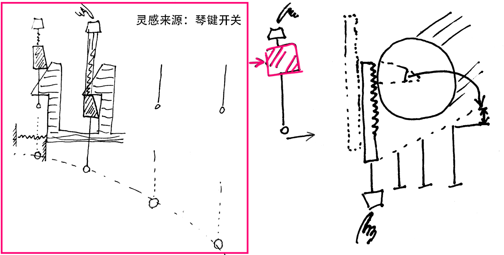

2. 在初代专利图中存在一个阶梯盘，猜测可根据阶梯实现位置定位。尚没有研究具体如何配合运动？一种可能是通过正反转来归位，
   键盘控制一个卡扣的位置使得滚筒卡在特定阶梯上。另一个问题在于如何做成3级嵌套？以及具体正反转的实现？（目前看可行性不如1）

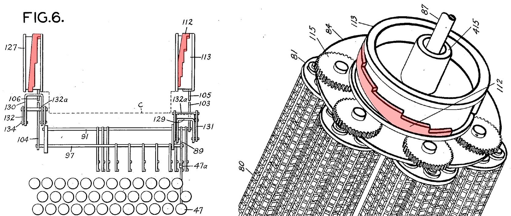

